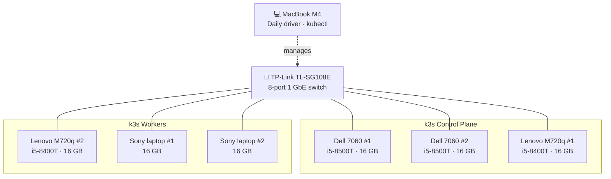

My homelab is a small bare-metal Kubernetes cluster built from refurbished mini PCs and laptops, running k3s on Arch Linux.

## Cluster Layout

## Cluster Nodes

| Device | CPU | RAM | Storage | OS | Role | Network |
|---|---|---|---|---|---|---|
| Dell OptiPlex 7060 Micro #1 | Intel Core i5-8500T (6C/6T, 2.1 GHz) | 16 GB | 256 GB SSD | Arch Linux + k3s | Control plane | 1 GbE |
| Dell OptiPlex 7060 Micro #2 | Intel Core i5-8500T (6C/6T, 2.1 GHz) | 16 GB | 256 GB SSD | Arch Linux + k3s | Control plane | 1 GbE |
| Lenovo ThinkCentre M720q #1 | Intel Core i5-8400T (6C/6T, 1.7 GHz) | 16 GB | 500 GB NVMe | Arch Linux + k3s | Control plane | 1 GbE |
| Lenovo ThinkCentre M720q #2 | Intel Core i5-8400T (6C/6T, 1.7 GHz) | 16 GB | 500 GB NVMe | Arch Linux + k3s | Worker | 1 GbE |
| Sony laptop #1 | TBD | 16 GB | 256 GB | Arch Linux + k3s | Worker | TBD |
| Sony laptop #2 | TBD | 16 GB | 256 GB | Arch Linux + k3s | Worker | TBD |

## Networking

| Device | Ports | Speed | Role |
|---|---|---|---|
| TP-Link TL-SG108E | 8 | 1 Gbps | Cluster switch |

## Workstation

| Device | Chip | RAM | Storage | Role |
|---|---|---|---|---|
| MacBook (M4) | Apple M4 | 32 GB | 500 GB | Daily driver, cluster management |

## Totals

| Nodes | CPU cores | RAM |
|---|---|---|
| 6 (3 control plane, 3 workers) | 24 + laptops | 96 GB |
